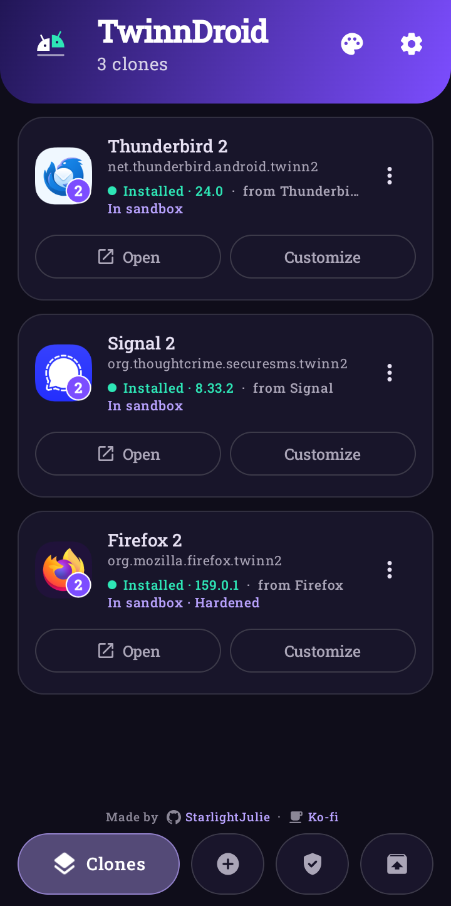
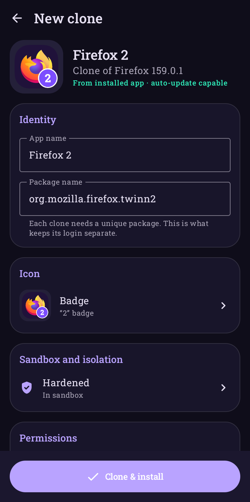
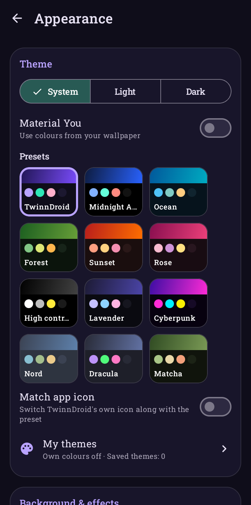
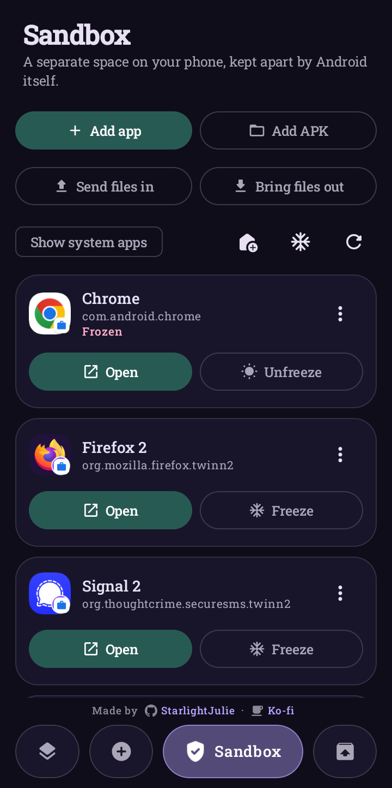
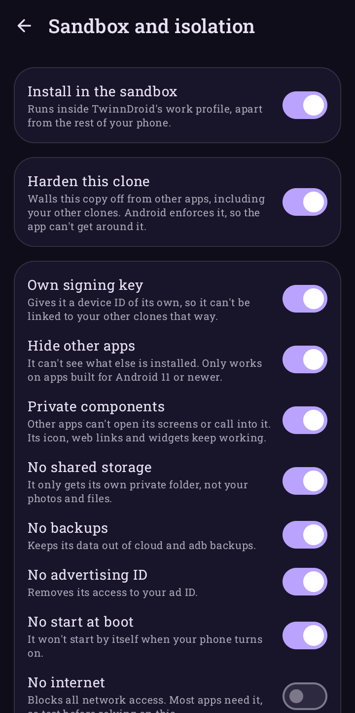

<div align="center">


# TwinnDroid

**Run two (or more) copies of the same Android app, each logged into a different account, and lock them away in a sandbox if you want.**

No root, no virtual space. Every copy is a real app, kept apart by Android itself.

[Download](../../releases/latest) · [Changelog](CHANGELOG.md) · [Support on Ko-fi](https://ko-fi.com/vvanadium)

<a href="../../releases/latest"></a>


<a href="LICENSE"></a>

<br><br>







</div>

---

## Why I made this

I was using Shelter to run a second copy of a couple of apps, but I wanted one place to keep all my alt accounts together, without root and without a work profile. So I built TwinnDroid. Pick an app, give the copy its own name and icon, and it installs next to the original with its own login and data.

## What it does

- **Sandboxes apps** in a separate space on your phone, with its own storage, accounts and contacts. It runs apps unchanged, so even ones that refuse to be cloned work in there, and it can hold as many clones as you like of any app that allows cloning
- **Hardens clones** so they can't see other apps or be reached by them, and can't be linked to your other clones
- **Clones apps** you already have installed, or an `.apk` / `.apks` / `.xapk` / `.apkm` file
- **Lets you rename them**, so you can tell "Discord" and "Discord (Alt)" apart
- **Changes the icon**: keep the original, add a coloured number badge, or use your own picture. You can also tweak hue, saturation, brightness, contrast, tint, flip and rotation, with a live preview
- **Removes permissions** you don't want a copy to have, like location or contacts
- **Keeps clones updated**: when the original app updates, you get a heads-up, and one tap updates the copy without logging you out
- **Extracts APKs** from any installed app (splits included) as `.apk`, `.apks`, `.xapk`, `.apkm`, or one merged `.apk`
- **Installs silently** if you use [Shizuku](https://shizuku.rikka.app/) (optional)
- **Looks how you want**: 14 animated backgrounds, 12 theme presets with matching app icons, your own colours and saved themes, Material You, a frosted-glass header and more
- **Backs everything up**, so you can move your clones and settings to a new phone
- **Speaks your language**: 23 languages, including the 20 most spoken in the world, from **Settings → Language** (Arabic and Urdu get a proper right-to-left layout)
- **Tells you when there's a new version** with a short pop-up and the release notes

## Where to download

**The only official place to get TwinnDroid is the [Releases page](../../releases/latest) here on GitHub.**

I haven't published it anywhere else yet. Copies on other app stores or APK sites weren't uploaded by me, may be out of date and could be modified, so please don't install those. When I'm ready to put TwinnDroid on F-Droid, Orion Store or Google Play, I'll add the links here myself.

Official builds are signed with my key. **Settings → About** shows **Official build** with a tick on a genuine copy, and [SECURITY.md](SECURITY.md) has the fingerprint if you want to check an APK yourself.

## What you need

- Android 8.0 or newer. I use it daily on a Galaxy S25 Ultra running Android 16.
- No root.

## Getting started

1. Grab `TwinnDroid.apk` from the [latest release](../../releases/latest).
2. Open it on your phone. If Android asks, let your browser or file manager install unknown apps.
3. Open TwinnDroid and go to the **New clone** tab (or just swipe left).
4. Pick the app you want to copy, or tap **From an APK file**.
5. Change the name, icon or permissions if you want, then tap **Clone & install**.
6. Confirm the install. The copy shows up in your app drawer, ready for your other account.

The first time, Android will ask you to let TwinnDroid install apps. Tap **Allow** on the banner in TwinnDroid or in the prompt.

## The sandbox

The **Sandbox** tab sets up a separate space on your phone. It's built on Android's work profile, the same thing companies use to keep work apps apart, except here you're the one in charge and TwinnDroid is the admin. Android keeps it separate, not TwinnDroid, so an app inside it can't reach out no matter what it tries.

Apps in the sandbox get their own storage, accounts, contacts and data. They can't see your other apps or your files.

Setting it up:

1. Open the **Sandbox** tab and tap **Create sandbox**.
2. Android walks you through a short setup. It talks about "work" and an "IT admin" because that's what the feature was built for. The admin here is TwinnDroid on your own phone, and nobody else can see anything.
3. The first time you add an app, Android asks you to turn on **Allow from this source** for TwinnDroid. It only needs doing once.

What you can do in there:

| | |
|---|---|
| **Add app** | Puts an unchanged copy of any app in the sandbox, system apps included |
| **Add APK** | Installs an `.apk`, `.apks`, `.xapk` or `.apkm` straight into the sandbox |
| **More copies** | For apps that can be cloned, make a clone as usual and turn on **Install in the sandbox**. There's no limit, and each copy has its own login |
| **Freeze** | Stops an app completely until you need it. **Auto-freeze** does it when your screen locks |
| **Shortcuts** | One tap on your home screen wakes a frozen app and opens it, or freezes everything |
| **Reset app data** | Wipes one app back to fresh, handy for testing |
| **Block permissions** | Turn off camera, location, contacts and more for any app, without touching the app |
| **Send files in / Bring files out** | Moves files across, into `Download/TwinnDroid` on the other side |
| **Copy to main profile** | Brings an app back out |
| **Rules** | Block copy and paste, block sharing in, block contact lookups, or let adb and Shizuku reach the sandbox for testing |

Things to know:

- **Android allows one work profile per phone.** If Shelter, Island or your job already has it, you'll need to remove that one first, and that deletes everything in it. TwinnDroid tells you if the slot's taken. Samsung's Secure Folder doesn't count, so it can stay.
- **Apps with anti-tamper protection work here, but only as the original.** Clash Royale crashes as a clone, hardened or not, because a clone is always a changed copy, and changing it is what sets the check off. Use **Add app** instead, or tap **Add original to sandbox** on the warning in the clone editor. It runs fine that way because nothing about it has been changed. I've tested that with Clash Royale and Clash of Clans on an S25 Ultra.
- **Those apps get one copy per Android profile.** A second copy in the same place would need a different package name, and that's exactly what they reject. So that's your normal install plus one in the sandbox. Samsung's Secure Folder or Android's Private Space could hold one more, but I haven't tested those yet.
- **Switching from Shelter?** TwinnDroid does what Shelter does, and for apps that can be cloned it can also hold several copies of the same app, where Shelter is limited to one.

## Hardened clones

In the clone editor, **Sandbox and isolation** lets you harden a clone. This works on any phone, with or without the sandbox. Android enforces all of it, so it isn't something an app can get around:

| Option | What it does |
|---|---|
| **Own signing key** | Gives it a device ID of its own, so it can't be linked to your other clones that way |
| **Hide other apps** | It can't see what else is installed (apps built for Android 11 or newer) |
| **Private components** | Other apps can't open its screens or call into it. Its icon, web links and widgets still work |
| **No shared storage** | It only gets its own private folder |
| **No backups** | Keeps its data out of cloud and adb backups |
| **No advertising ID** | Removes its access to your ad ID |
| **No start at boot** | It won't start by itself when your phone turns on |
| **No internet** | Blocks all network access. Most apps need it, so test first |

Put the two together and you get a hardened clone inside the sandbox, which is as walled off as Android allows without root.

## Updating TwinnDroid

When a new version is out, TwinnDroid shows a pop-up when you open it with what's new. **Update now** takes you to the latest release here, and the new APK installs straight over your current one. You can turn the check off in **Settings → Updates**.

## Updating clones

Every few hours TwinnDroid checks whether the originals have updated. If one has, you get a notification and the clone shows **Update available**. Tap **Update** and it rebuilds from the new version and installs over the old copy. Your login and data stay put.

If you turn on Shizuku and **Settings → Auto-update in background**, this happens without you doing anything.

## Shizuku (optional, still no root)

With Shizuku, TwinnDroid can install clones without the "Install?" prompt every time, and grant clones their special permissions in one tap.

1. Install **Shizuku** from the [Play Store](https://play.google.com/store/apps/details?id=moe.shizuku.privileged.api) or [GitHub](https://github.com/RikkaApps/Shizuku/releases).
2. Turn on **Developer options → Wireless debugging** and follow Shizuku's pairing steps.
3. Start Shizuku, then in TwinnDroid go to **Settings → Authorize TwinnDroid**.

You'll need to start Shizuku again after each restart.

## Clones that ask for special permissions

Some apps, managers and patchers especially, need **All files access** or **Install unknown apps**. Those are granted from a Settings page, and the app's own "Open settings" button takes you to the page for the *original* app instead of the clone, so you end up stuck.

TwinnDroid shows a **"Needs … · tap to grant"** line on any clone that's missing one. Tap it (or use **⋮ → Special access**) and either:

- tap **Grant** to allow it right away (needs Shizuku), or
- tap **Open settings** to go to the clone's own page and switch it on there.

I've tested this with Revenge Manager, Shiggy Manager and Morphe.

## Extracting APKs

Open the **Extract** tab, pick an app, and choose a format:

| Format | Good for |
|---|---|
| **APK** | Apps that are a single file |
| **Merged** | Apps that come in splits, combined into one `.apk` you can install anywhere. It gets re-signed, so it installs as a separate copy rather than updating the original. |
| **APKS** | The original split set, for SAI or TwinnDroid |
| **XAPK** | APKPure-style bundle with app info and icon |
| **APKM** | APKMirror-style bundle (unencrypted) |

Everything except Merged keeps the app's original signature.

## Making it yours

Tap the palette button on the Clones tab:

| Setting | What it does |
|---|---|
| **Background & effects** | Space, Particles, Circles, Rings, Mesh, Shapes, Snow, Grid, Lava lamp, Aurora, Waves, Fireflies, Bokeh, Meteors, None or Random, plus tilt **Parallax**. **Preview background** hides everything so you can just watch it. Animations pause when TwinnDroid is in the background and turn off if you've disabled animations in Android. The look was inspired by [Morphe Patcher](https://github.com/MorpheApp/morphe-manager). |
| **Home header** | Gradient, Glass, Solid or None, with opacity, real blur (Android 12+), roundness and a floating style. You can also put frosted pills behind the icon, title and buttons. |
| **Presets** | TwinnDroid, Midnight AMOLED, Ocean, Forest, Sunset, Rose, High contrast, Lavender, Cyberpunk, Nord, Dracula, Matcha. Turn on **Match app icon** and TwinnDroid's icon changes with the theme. |
| **My themes** | Drop-downs for custom colours, background & effects, text size and the home header. Save the whole look under a name and switch between your themes with one tap. |
| **System / Light / Dark** | Follow your phone or pick one |
| **Material You** | Colours from your wallpaper (Android 12+) |
| **Custom colours** | Pick each colour yourself with a picker or hex code |
| **Pure black, glass cards, outlines** | For OLED screens and a lighter or crisper look |
| **Text size** | 85% to 140% |
| **App icon** | 12 built-in icons, or a home-screen shortcut with your own picture |

## Back up TwinnDroid

TwinnDroid signs every clone with its own key. **If you uninstall TwinnDroid without a backup, that key is gone**, and you'd have to uninstall and recreate your clones to update them.

**Settings → Backup & restore → Back up** saves your clone list, signing key, imported APKs, icons and settings to one file. After reinstalling or on a new phone, use **Restore**.

Coming from 1.0.0? 1.1.0 switched to a new release key, so you'll need to uninstall 1.0.0 first. Export your key in 1.0.0 (**Settings → Signing key → Export**) before you do, then **Import** it in the new version so your clones keep updating.

## Which apps work?

Most do. I've used it with various social media apps, multiple tools apps, notes, and shopping apps.

Some apps protect themselves, and those **won't work as clones**. TwinnDroid spots the common ones and warns you in the editor before you build, so you don't waste time on a copy that just crashes:

- **Apps with anti-tamper protection** (Promon SHIELD and similar). They check that they haven't been modified and close straight away if they have. Supercell games like Clash Royale and Clash of Clans do this. No no-root cloner can get around it, and hardening a clone doesn't help. **The sandbox can run them**, though, because it doesn't change the app at all. You get one copy in there, on top of your normal install.
- **Banking and payment apps**, for the same reason. These may work in the sandbox too, though some refuse to run in a work profile.
- **Apps that use Google Play Integrity**, or tie *Sign in with Google* to the original app. A clone is signed with a different key, so sign-in may fail even if the app opens. This is the app checking its own signature, not a missing Google Play Services issue, so MicroG won't help.

A couple of other things:

- **Push notifications** may not reach clones, since they're registered to the original app.
- Some apps can crash when you **share a file** from the clone.

Other cloning apps run into the same limits.

## Troubleshooting

| Problem | Try this |
|---|---|
| "App not installed" or a conflict error | There's already a clone with that package signed by a different key. Uninstall the old clone and build again. |
| Clone closes as soon as it opens | The app is probably protected against tampering. The editor shows a red warning for these, and they can't run as clones. See [Which apps work?](#which-apps-work) |
| Clone keeps asking for file access or "install apps" | Grant it from TwinnDroid: tap the **Needs … · tap to grant** line on the clone. See [Clones that ask for special permissions](#clones-that-ask-for-special-permissions). |
| Clone stuck on its loading screen | Rebuild it with **⋮ → Rebuild & reinstall**. If it still hangs, open an issue with the app name and version. |
| Shizuku says "not running" | Start Shizuku again (it's needed after every restart) and reopen TwinnDroid. |
| App icon didn't change | The new icon kicks in once you leave TwinnDroid. Give your launcher a few seconds, and re-add TwinnDroid to your home screen if needed. |

---

## For developers

<details>
<summary><b>How cloning works</b></summary>

```
source APKs (base + splits)
  └─► ARSCLib: edit the binary AndroidManifest + resources.arsc of every APK
        • package name → new name (manifest and resource table)
        • relative class names (.Foo) → absolute
        • <provider android:authorities>, custom <permission>s and their references → unique
        • taskAffinity rewritten; sharedUserId + instrumentation removed
        • base APK: label, icon (new drawable resource), removed permissions, debuggable
  └─► strip old signatures / source stamp
  └─► apksig: sign v2 + v3 (+ v1 if minSdk < 24), 16 KB page-aligned
  └─► PackageInstaller session, or Shizuku `pm install-*` (all splits at once)
```

Because the clone has a new package name, Android gives it its own data folder, and that's what keeps the logins separate. LSPatch isn't needed: it keeps the original package name, so on its own it can't make side-by-side copies, and its hooks run inside the app, so it can't isolate anything either.

</details>

<details>
<summary><b>How the sandbox works</b></summary>

TwinnDroid becomes the profile owner of a work profile through Android's normal setup, which also puts a second copy of TwinnDroid inside it. That inner copy has no icon or UI. It holds the owner's powers and does what the main copy asks.

Apps can't call across profiles, so the two copies talk through Android's intent forwarding. The inner copy allows two actions across the boundary, one each way. Each command starts an invisible activity on the far side and answers on a `ResultReceiver`, and only apps signed with TwinnDroid's key can start it. APKs and files cross as content URIs, read straight from where they already are.

Clones get hardened at build time in `ManifestPatcher.harden`, so every wall is something Android enforces from the manifest, rather than code running inside the app.

</details>

<details>
<summary><b>Building from source</b></summary>

You'll need JDK 17+ and the Android SDK (platform 36, build-tools 36.0.0).

```bash
./gradlew assembleDebug
# → app/build/outputs/apk/debug/app-debug.apk
```

Release builds (R8-minified) are signed with your own key. Put a `keystore.properties` in the project root or in `~/.twinndroid-signing/` (and don't commit it):

```properties
storeFile=/path/to/release.jks
storePassword=...
keyAlias=...
keyPassword=...
```

Or set `TWINN_KEYSTORE_FILE`, `TWINN_KEYSTORE_PASSWORD`, `TWINN_KEY_ALIAS` and `TWINN_KEY_PASSWORD`. Without a key, release builds fall back to the debug key.

```bash
./gradlew assembleRelease
```

To test the clone engine on your PC against any APK set (output goes to `app/build/clone-test/`):

```bash
TWINN_TEST_APKS=base.apk,split_config.arm64_v8a.apk ./gradlew :app:testDebugUnitTest
```

Where things live:

| Path | What |
|---|---|
| `engine/` | `ManifestPatcher`, `CloneEngine` (patch + sign), `ApkExporter` (extract/merge), `ApkSources`, `TamperScan`, `IconFactory`, `SigningKeys` |
| `install/` | `SessionInstaller` (PackageInstaller), `ShizukuInstaller` + `ShellService`, `SpecialAccess` |
| `sandbox/` | `SandboxPolicy` (runs inside the profile as its owner), `SandboxBridge` + `SandboxBridgeActivity` (commands across the profile boundary), `Sandbox` (the main-profile side), `SandboxFileProvider` |
| `ui/` | Compose screens and the tab pager, `theme/` (presets, palette → Material 3 scheme, `AnimatedBackground`), `AppIcons` |
| `data/` | Clone configs, settings, `BackupManager` |
| `UpdateWorker.kt` | Periodic update check and auto-update |

</details>

## Support

TwinnDroid is free and open source. If it's been useful to you, you can buy me a coffee on Ko-fi:

<a href="https://ko-fi.com/vvanadium"></a>

## Contributing

Bug reports and pull requests are welcome, and so are fixes to the translations. If a clone isn't working, please include the **app name, app version and your Android version** so I can look into it.

## License

TwinnDroid is free and open source under the [GNU General Public License v3](LICENSE), with a few [additional terms](ADDITIONAL-TERMS.md). You're welcome to read the code, learn from it, build it yourself and improve it.

In short, if you share a modified version of TwinnDroid:

- it has to stay open source under the same license,
- it has to keep my credit ("StarlightJulie", linking to my GitHub) in the code, the README and the About screen,
- it has to say clearly that it's modified and not the official release,
- and it needs its own name and icon, signed with your own key. The TwinnDroid name and split-droid logo are for my official builds.

Please don't re-upload my releases to other stores or sites; link to this page instead. Versions up to and including 1.1.4 were released under the MIT License.

It's built on these open-source projects:

- [ARSCLib](https://github.com/REAndroid/ARSCLib) (Apache 2.0): binary manifest and resource editing. `app/libs/arsclib-1.4.0-android.jar` is the Maven Central release with its bundled `android.*` / `org.xmlpull.*` stub classes removed.
- [apksig](https://android.googlesource.com/platform/tools/apksig/) (Apache 2.0): APK signing
- [Shizuku API](https://github.com/RikkaApps/Shizuku-API) (Apache 2.0)
- [Bouncy Castle](https://www.bouncycastle.org/) (MIT)
- Jetpack Compose, Material 3, WorkManager (Apache 2.0)

The background animations and appearance settings were inspired by [Morphe Patcher](https://github.com/MorpheApp/morphe-manager)'s design. TwinnDroid's code is its own and doesn't include any of Morphe's.

TwinnDroid isn't affiliated with any of the apps you clone. Please use clones in line with each app's terms of service.
